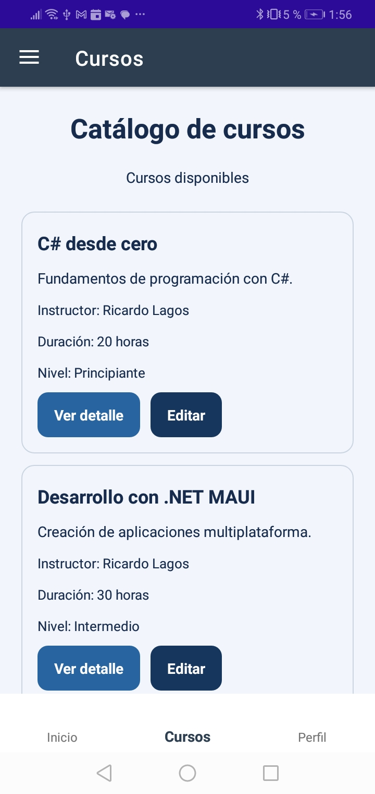
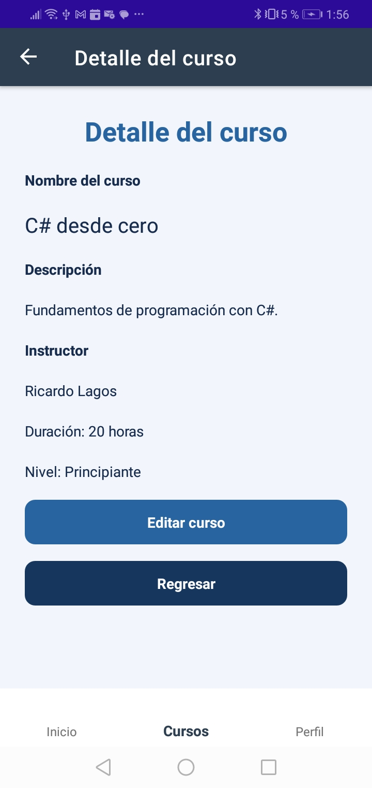
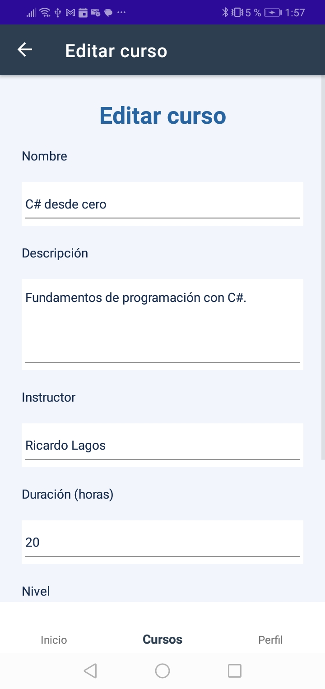
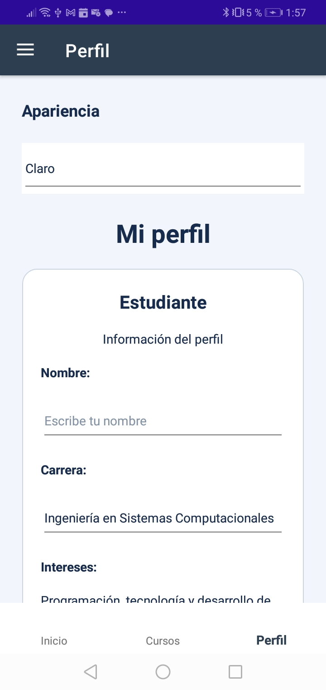
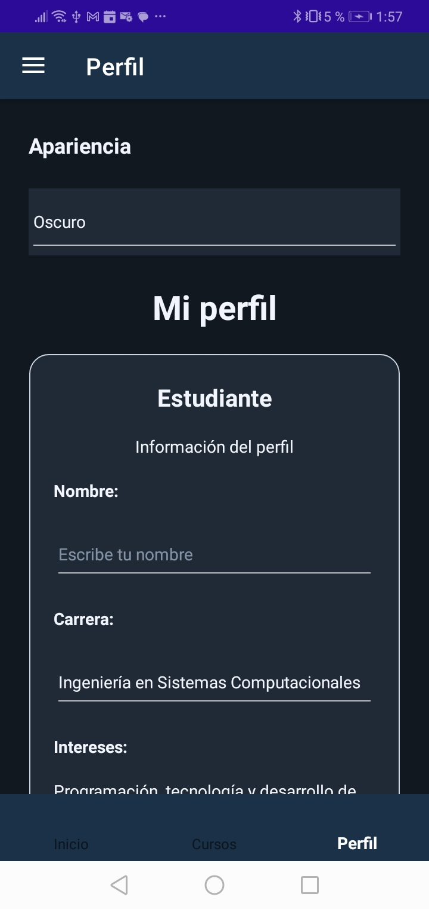
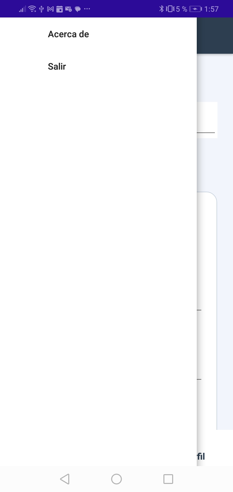

# Catálogo de Cursos - Tarea 4

Aplicación multiplataforma desarrollada con **.NET MAUI y Shell** para consultar, visualizar y editar cursos. Este proyecto implementa navegación mediante pestañas, menú lateral y rutas con parámetros.

## Tecnologías utilizadas

- C#
- .NET MAUI (.NET 10)
- XAML
- Shell para navegación
- Git y GitHub

## Funcionalidades

- Navegación mediante tres pestañas: Inicio, Cursos y Perfil.
- Menú lateral con las opciones Acerca de y Salir.
- Catálogo de cinco cursos almacenados en memoria.
- Consulta del detalle de un curso mediante su identificador.
- Edición de cursos mediante el envío del objeto completo.
- Regreso a la pantalla anterior y actualización de la lista.
- Selector de apariencia: automático, claro y oscuro.
- Diseño adaptable a Windows y Android.

## Mapa de rutas

| Pantalla u opción | Ruta o mecanismo										|

| Inicio			| `//Principal/InicioPage`								|
| Cursos			| `//Principal/CursosPage`								|
| Perfil			| `//Principal/PerfilPage`								|
| Detalle del curso | `DetalleCursoPage?Id={id}`							|
| Editar curso		| `EditarCursoPage`, con el objeto `CursoSeleccionado`	|
| Regresar			| `..`													|
| Acerca de			| Opción del menú lateral								|
| Salir				| Opción del menú lateral								|

Las rutas `DetalleCursoPage` y `EditarCursoPage` se registran mediante `Routing.RegisterRoute` en `AppShell.xaml.cs`.

## Parámetros de navegación

### Envío del identificador

La pantalla `CursosPage` envía el identificador del curso a `DetalleCursoPage` mediante la cadena de consulta `Id`. La pantalla de detalle utiliza ese valor para localizar y mostrar la información del curso seleccionado.

### Envío del objeto completo

Para editar un curso, se envía el objeto `Curso` mediante un diccionario de parámetros con la clave `CursoSeleccionado`. La pantalla `EditarCursoPage` utiliza sus datos para completar el formulario.

### Regreso y actualización

Las pantallas de detalle y edición regresan mediante `Shell.Current.GoToAsync("..")`. La lista de cursos se actualiza en `OnAppearing` de `CursosPage`.

## Estructura principal del proyecto

- `AppShell.xaml`: estructura de navegación de Shell.
- `AppShell.xaml.cs`: registro de rutas y acciones del menú lateral.
- `InicioPage.xaml`: pantalla de bienvenida.
- `CursosPage.xaml`: catálogo de cursos.
- `DetalleCursoPage.xaml`: detalle del curso seleccionado.
- `EditarCursoPage.xaml`: formulario de edición.
- `PerfilPage.xaml`: perfil y selector de apariencia.
- `Models/Curso.cs`: modelo de datos del curso.
- `Models/CursosRepositorio.cs`: lista de cursos de demostración.
- `Resources/Styles/Colors.xaml`: paleta de colores.
- `Resources/Styles/Styles.xaml`: estilos compartidos.

## Paleta de colores

| Nombre			| Código hexadecimal	|

| Azul principal	| `#2864A0`				|
| Azul oscuro		| `#17365D`				|
| Verde de éxito	| `#23845D`				|
| Fondo claro		| `#F2F6FC`				|
| Superficie clara	| `#FFFFFF`				|
| Texto oscuro		| `#172B4D`				|
| Borde claro		| `#CBD5E1`				|
| Fondo oscuro		| `#121820`				|
| Superficie oscura	| `#202A36`				|
| Borde oscuro		| `#536273`				|

## Capturas de pantalla

### Inicio

### Catálogo de cursos

### Detalle del curso

### Edición de un curso

### Perfil y selector de apariencia

### Modo oscuro

### Menú lateral

## Ejecución

Abrir la solución en Visual Studio con soporte para .NET MAUI, restaurar las dependencias y ejecutar el proyecto en Windows o en un emulador Android compatible.

**Nota:** Los cursos y sus modificaciones se almacenan en memoria durante la ejecución. Los cambios no se conservan al cerrar la aplicación.

## Autor

Grupo N°3 de la clase de programacion de dispositivos móviles II.
